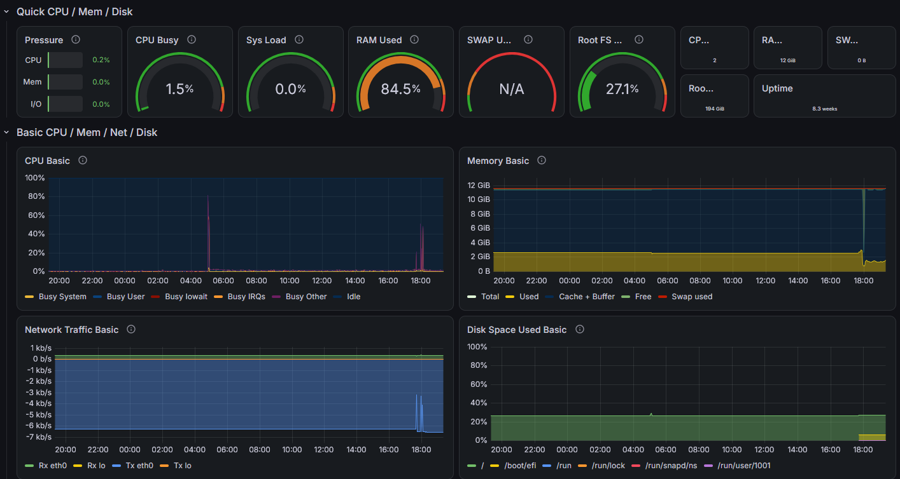

# server-monitoring


🌐 [English](README.md) | **Español**

Este es un stack de monitorización que he montado para aprender cómo funcionan Prometheus y Grafana en la práctica, usando un servidor real en Oracle Cloud que ya tenía en marcha.

## Contexto

Soy un estudiante de ingeniería de telecomunicaciones metiéndome en el mundo de las infraestructuras. Quería trabajar con herramientas que resuelven problemas reales. Además, hice algo de investigación por mi cuenta para entender cómo funcionan Prometheus y Grafana, más allá de simplemente leer documentación — así que usé una VM en Oracle Cloud que ya tenía (que corre un servidor de Minecraft) como objetivo a monitorizar. Al final el servidor de Minecraft es la excusa para aprender Docker Compose en condiciones.

## Qué hace


*Panel de control de Minecraft — TPS, MSPT, jugadores y entidades en tiempo real*



*Panel de control del sistema — CPU, RAM, red y disco*

- Recoge métricas del sistema (CPU, RAM, disco, red) desde el host usando Node Exporter
- Recoge métricas específicas del servidor de Minecraft (TPS, MSPT, jugadores online, entidades cargadas) usando FabricExporter + Spark
- Almacena todo en Prometheus
- Lo visualiza en Grafana con dos dashboards

## Stack

- **Prometheus** — recoge y almacena las métricas
- **Grafana** — dashboards y visualización
- **Node Exporter** — métricas a nivel de sistema
- **FabricExporter** — métricas del servidor de Minecraft (requiere el mod Spark)
- **Docker Compose** — lo une todo
- **Oracle Cloud** — donde corre (Ubuntu 20.04, ARM)

## Arquitectura

```text
Navegador
  │
  └── :3000  →  Grafana
                  │
              Prometheus  ←──  Node Exporter   (métricas del sistema)
                  │
                  └──────────  FabricExporter  (métricas de Minecraft, vía Crafty Controller)
```

Solo Grafana (puerto 3000) está publicado hacia fuera. Prometheus escucha únicamente en `127.0.0.1` y Node Exporter no publica ningún puerto — se comunican entre ellos por la red interna de Docker.

## Instalación

### Requisitos previos

- Docker y Docker Compose instalados
- Un servidor de Minecraft con Fabric (si quieres el dashboard de Minecraft)
- Puerto 3000 abierto en el firewall (interfaz de Grafana) — ver [Firewall](#firewall-security-list-de-oracle-cloud)

### Arrancarlo

```bash
git clone https://github.com/peristack/server-monitoring
cd server-monitoring
cp .env.example .env   # después edita .env y pon una GRAFANA_ADMIN_PASSWORD segura
docker compose up -d
```

Grafana estará disponible en `http://ip-de-tu-servidor:3000`. Inicia sesión con el usuario y la contraseña que hayas puesto en `.env`. La fuente de datos de Prometheus se configura automáticamente.

> [!NOTE]
> Grafana solo lee `GRAFANA_ADMIN_PASSWORD` la primera vez que arranca. Para cambiarla después, hazlo desde la interfaz de Grafana o ejecuta `docker exec -it grafana grafana cli admin reset-admin-password <nueva-contraseña>`.

Para abrir la interfaz de Prometheus, usa un túnel SSH y entra en `http://localhost:9090`:

```bash
ssh -L 9090:localhost:9090 usuario@ip-de-tu-servidor
```

### Firewall (Security List de Oracle Cloud)

Oracle Cloud bloquea todo el tráfico entrante por defecto, así que cada puerto hay que abrirlo en la Security List de la subred (*Networking → Virtual Cloud Networks → tu VCN → Security Lists → Ingress Rules*). Estas son las reglas que uso:

| Puerto | Protocolo | Origen | Para qué |
|---|---|---|---|
| 22 | TCP | `TU_IP/32` | SSH |
| 3000 | TCP | `TU_IP/32` | Grafana |
| 25565 | TCP | `0.0.0.0/0` | Minecraft (jugadores) |

No añadas reglas para el 9090 (Prometheus) ni el 25585 (FabricExporter): solo Prometheus necesita acceder a ellos, desde dentro del servidor. Los puertos que publica Docker se saltan UFW, así que es la Security List la que los mantiene privados.

> [!TIP]
> La IP de casa cambia de vez en cuando. Si de repente el SSH o Grafana dejan de responder, mira tu IP pública actual y actualiza las reglas `/32`.

### Métricas de Minecraft (opcional)

Instala estos mods en tu servidor Fabric:

- [Spark](https://modrinth.com/mod/spark) — proveedor de métricas de rendimiento, proporciona TPS y MSPT
- [FabricExporter](https://modrinth.com/mod/fabricexporter) — expone métricas en formato Prometheus

FabricExporter escucha en el puerto 25585 por defecto. Prometheus lo alcanza en el host a través de `host.docker.internal:25585`; si tu servidor está en otra máquina, actualiza `prometheus/prometheus.yml` con su dirección. No abras el puerto 25585 en el firewall — solo Prometheus necesita acceder a él.

### Dashboards

Impórtalos desde la librería de dashboards de Grafana:

- **Node Exporter Full** — ID `1860` (métricas del sistema)
- **Minecraft Fabric** — ID `14492` (métricas del juego)

## Qué he aprendido

- Cómo funciona el scraping de Prometheus y cómo configurar los targets
- Cómo clasifica Prometheus los diferentes tipos de métricas y por qué importa
- Cómo conecta Grafana con fuentes de datos y cómo funcionan las variables de los dashboards
- Redes Docker entre contenedores (por qué `container_name:port` funciona internamente)
- Seguridad básica en cloud: mantener los servicios internos fuera de los puertos públicos

## Notas

Este es un proyecto de aprendizaje, no está preparado para un entorno real. Algunas cosas que mejoraría con más tiempo:

- Añadir Alertmanager para recibir notificaciones cuando el TPS baje o el disco se llene
- Configurar una autenticación más robusta que el login básico de Grafana
- Poner Grafana detrás de un proxy inverso con HTTPS
