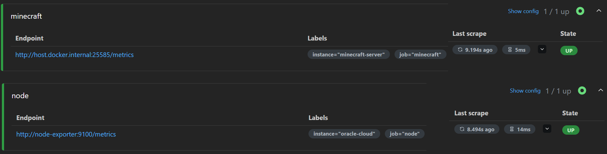

# server-monitoring


🌐 **English** | [Español](README.es.md)

A monitoring stack I've built to learn how Prometheus and Grafana work in practice, using a real Oracle Cloud server I already had running.

## Background

I'm a telecoms engineering student getting into infrastructure. I wanted to work with tools that are able to solve real problems. In addition, I've done some infrastructure research on my own to understand what Prometheus + Grafana were actually about beyond just reading docs, so I used an Oracle Cloud VM I already had (which runs a Minecraft server) as the target to monitor. It has ended up being a good excuse to learn Docker Compose properly too.

## What it does


*Minecraft server dashboard — TPS, MSPT, players and entities in real time*


*System dashboard — CPU, RAM, network and disk*

- Collects system metrics (CPU, RAM, disk, network) from the host using Node Exporter
- Collects Minecraft-specific metrics (TPS, MSPT, players online, loaded entities) using FabricExporter + Spark
- Stores everything in Prometheus
- Visualises it all in Grafana with two dashboards

## Stack

- **Prometheus** — scrapes and stores metrics
- **Grafana** — dashboards and visualisation
- **Node Exporter** — system-level metrics
- **FabricExporter** — Minecraft server metrics (requires Spark mod)
- **Docker Compose** — ties it all together
- **Oracle Cloud** — where it runs (Ubuntu 20.04, ARM)

## Architecture

```text
Browser
  │
  └── :3000  →  Grafana
                  │
              Prometheus  ←──  Node Exporter   (system metrics)
                  │
                  └──────────  FabricExporter  (Minecraft metrics, via Crafty Controller)
```

Only Grafana (port 3000) is published to the outside. Prometheus is bound to `127.0.0.1` and Node Exporter isn't published at all — they talk to each other over the internal Docker network.


*Prometheus targets — both exporters up and being scraped*

## Setup

### Prerequisites

- Docker and Docker Compose installed
- A Fabric Minecraft server (if you want the Minecraft dashboard)
- Port 3000 open on your firewall (Grafana UI) — see [Firewall](#firewall-oracle-cloud-security-list)

### Run it

```bash
git clone https://github.com/peristack/server-monitoring
cd server-monitoring
cp .env.example .env   # then edit .env and set a strong GRAFANA_ADMIN_PASSWORD
docker compose up -d
```

Grafana will be available at `http://your-server-ip:3000`. Log in with the user and password you set in `.env`. The Prometheus data source is provisioned automatically.

> [!NOTE]
> Grafana only reads `GRAFANA_ADMIN_PASSWORD` the first time it starts. To change it later, use the Grafana UI or run `docker exec -it grafana grafana cli admin reset-admin-password <new-password>`.

To open the Prometheus UI, use an SSH tunnel and browse to `http://localhost:9090`:

```bash
ssh -L 9090:localhost:9090 user@your-server-ip
```

### Firewall (Oracle Cloud Security List)

Oracle Cloud blocks all incoming traffic by default, so each port has to be opened in the subnet's Security List (*Networking → Virtual Cloud Networks → your VCN → Security Lists → Ingress Rules*). These are the rules I use:

| Port | Protocol | Source | Why |
|---|---|---|---|
| 22 | TCP | `YOUR_IP/32` | SSH |
| 3000 | TCP | `YOUR_IP/32` | Grafana |
| 25565 | TCP | `0.0.0.0/0` | Minecraft (players) |

Don't add rules for 9090 (Prometheus) or 25585 (FabricExporter): only Prometheus needs to reach them, from inside the server. Ports published by Docker bypass UFW, so the Security List is what actually keeps them private.

> [!TIP]
> Home IPs change from time to time. If SSH or Grafana suddenly time out, check your current public IP and update the `/32` rules.

### Minecraft metrics (optional)

Install these mods on your Fabric server:

- [Spark](https://modrinth.com/mod/spark) — performance profiler, provides TPS and MSPT
- [FabricExporter](https://modrinth.com/mod/fabricexporter) — exposes metrics in Prometheus format

FabricExporter listens on port 25585 by default. Prometheus reaches it on the host through `host.docker.internal:25585`; if your server runs somewhere else, update `prometheus/prometheus.yml` with its address. Don't open port 25585 on your firewall — only Prometheus needs to reach it.

### Dashboards

Import these from Grafana's dashboard library:

- **Node Exporter Full** — ID `1860` (system metrics)
- **Minecraft Fabric** — ID `14492` (game metrics)

## What I learned

- How Prometheus scraping works and how to configure targets
- How Prometheus classifies different types of metrics and why it matters
- How Grafana connects to data sources and how dashboard variables work
- Docker networking between containers (why `container_name:port` works internally)
- Basic cloud security: keeping internal services off public ports

## Notes

This is a learning project, not battle-tested for real-world use. A few things I'd improve with more time:

- Add Alertmanager for notifications when TPS drops or disk fills up
- Set up proper authentication beyond basic Grafana login
- Put Grafana behind a reverse proxy with HTTPS
